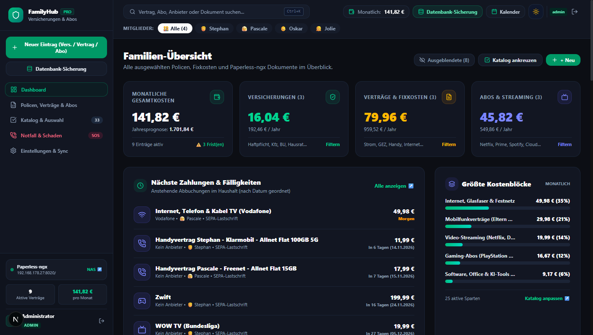
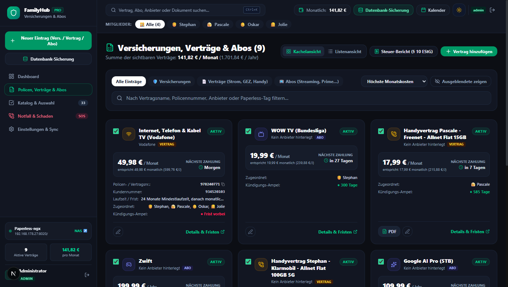
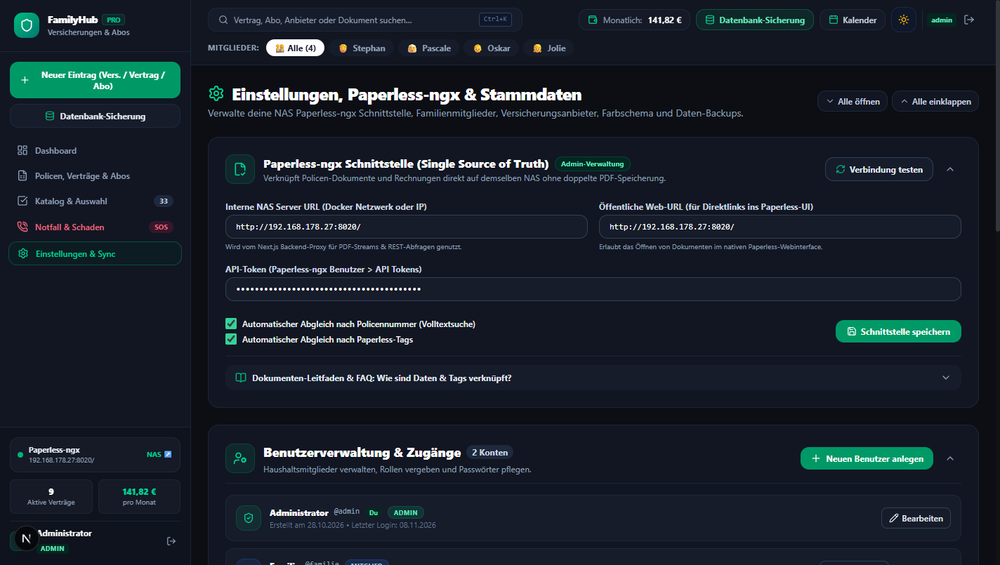

# 🛡️ FamilyHub – Versicherungs-, Vertrags- & Abo-Manager

Eine moderne, selbstgehostete All-in-One Webanwendung zur zentralen Verwaltung aller **Familienversicherungen**, **Verträge/Fixkosten** (z. B. Strom, Internet, GEZ) und **Abonnements** (Streaming, Software, Mitgliedschaften) – inklusive **Paperless-ngx NAS-Integration** als Single Source of Truth, **Bedarfskompass**, **Fristen-Kalender (iCal)** und **mobiler Notfall-Mappe**.



---

## ✨ Highlights & Features

### 1. 🗂️ 3-Wege-Kategorisierung & Übersicht
* **Versicherungen:** Haftpflicht, Hausrat, BU, Kfz, Rechtsschutz, Krankenzusatz etc.
* **Verträge & Fixkosten:** Strom, Gas, DSL/Glasfaser, Handyverträge, GEZ (Rundfunkbeitrag), Fitnessstudio.
* **Abos & Streaming:** Netflix, Spotify, Amazon Prime, Cloud-Speicher, Software-Lizenzen.
* **Filterung & Sortierung:** Nach Familienmitgliedern, Kosten, Kündigungsfristen oder Volltextsuche.
* **Detaillierte Kostenmetriken:** Monatliche Gesamtkosten, Jahressummen und Erkennung der größten Kostenblöcke.



---

### 2. ⏳ Maximal variable Vertragslaufzeiten & Fristen
* **Vertragsbeginn & Erstlaufzeit:** Z. B. 24 Monate Mindestlaufzeit, 12 Monate oder flexibel.
* **Automatische Verlängerung:** Nach Ablauf der Erstlaufzeit monatlich kündbar (nach aktuellem Verbraucherrecht) oder z. B. um 12 Monate verlängernd.
* **Variable Kündigungsfristen:** Flexible Einheiten wie Tage, Wochen oder Monate (z. B. *1 Monat zum Monatsende*, *3 Monate zum Vertragsende*).
* **Kündigungs-Ampel:** Visuelle Ampel (Grün / Gelb / Rot) warnt rechtzeitig vor Ablauf von Kündigungsfristen.
* **Individuelle Zusatzfelder & Kundennummer:** Eigene Kennziffern und Notizen spezifisch für jeden Vertrag.

---

### 3. 📄 Paperless-ngx NAS-Integration (Single Source of Truth)
* **Keine doppelten PDFs:** Alle Originalverträge, Rechnungen und Nachträge bleiben sicher in deinem Paperless-Archiv auf dem NAS.
* **Automatisches Matching:** Dokumente werden vollautomatisch anhand von **Policennummer**, **Paperless-Tags** oder **Korrespondent (Versicherer)** zugeordnet.
* **Sichere In-App PDF-Vorschau:** Mit nur einem Klick PDFs direkt im Browser ansehen, herunterladen oder im Paperless-Webinterface öffnen.
* **Schutz vor toten Links:** Bei reinen Online-Abos ohne Beleg wird die Dokumentenvorschau automatisch ausgeblendet.

---

### 4. 🔒 Multi-User & Rollensystem
* **Admin & Haushaltsmitglieder:** Sichere Anmeldung mit Benutzername und Passwort.
* **Superuser `admin`:** Vollzugriff auf Benutzerverwaltung und globale API-Token.
* **Zentraler Paperless-Schlüssel:** Der Paperless API-Token wird nur vom Admin gepflegt und gilt global für alle Familienmitglieder.
* **Eingeschränkte Mitgliedsansicht:** Familienmitglieder sehen nur freigegebene Verträge und Daten.

---

### 5. 💾 Datenbank-Sicherung & Portabilität
* **Integrierte Backup-Funktion:** Ein Klick auf **„Datenbank-Sicherung“** im Menü öffnet den Export-Assistenten.
* **Dual-Format-Export:**
  * **JSON-Snapshot (`.json`):** Vollständiges, strukturgetreues Backup aller Verträge, Mitglieder, Kategorien und Einstellungen für 1-Klick-Wiederherstellung.
  * **Excel/Tabellen-Export (`.csv`):** Bereinigte tabellarische Auswertung für Tabellenkalkulationen.
* **Host-Persistent:** Daten liegen im Ordner `./pb_data` auf dem Host und bleiben bei Container-Updates (`docker compose up -d --build`) vollständig erhalten.

---

### 6. ⚙️ Aufgeräumte Einstellungen & Design
* **Einklappbare Bereiche:** Alle Konfigurationsfenster (Paperless, Benutzer, Mitglieder, Anbieter, Backups) lassen sich per Klick ein- und ausklappen.
* **Schnell-Toggles:** „Alle öffnen“ / „Alle einklappen“ mit dauerhafter Speicherung deines bevorzugten Zustands.
* **Hell- & Dunkelmodus (Dark Mode):** Wählbar zwischen Hell, Dunkel oder automatischer Anpassung an das Betriebssystem.



---

### 7. 📅 Kalender-Abo & Notfall-Mappe
* **WebCal / iCal Fristen-Export:** Alle Kündigungstermine und Abbuchungsdaten direkt mit Apple Kalender, Google Kalender, Outlook oder Thunderbird abonnieren.
* **Notfall-Mappe („Der rote Ordner“):** Übersichtlicher Kompaktausdruck mit allen Notfall-Hotlines, Policennummern und Ansprechpartnern für Angehörige im Ernstfall.
* **Steuer-Bericht (§ 10 EStG):** Automatisierte Zusammenstellung aller steuerlich absetzbaren Vorsorgeaufwendungen für Elster oder WISO.

---

## 🚀 Installation & Betrieb

### Voraussetzungen
* Docker & Docker Compose installiert (z. B. auf Synology, QNAP, Unraid, OMV oder Linux-Server)
* (Optional) Laufende Paperless-ngx Instanz im selben Netzwerk

---

### Schnellstart mit Docker Compose (Produktivbetrieb)

1. **Repository klonen:**
   ```bash
   git clone https://github.com/Schilla0815/family-insurance-hub.git
   cd family-insurance-hub
   ```

2. **Umgebungsvariablen anpassen:**
   Kopiere die `.env.example` Datei:
   ```bash
   cp .env.example .env
   ```
   Trage in `.env` optional deine Paperless-Adresse und PocketBase-Konfiguration ein (kann auch später bequem über die Web-Oberfläche eingestellt werden).

3. **Container bauen und starten:**
   ```bash
   docker compose up -d --build
   ```

4. **Web-App aufrufen:**
   Öffne deinen Browser unter:
   ```
   http://<NAS-IP>:3000
   ```
   * **Standard-Superuser:** `admin` / Passwort: `admin` (bitte nach dem ersten Login unter *Einstellungen ➔ Benutzerverwaltung* ändern!)

---

### Update auf dem NAS (z. B. OpenMediaVault, Synology, Unraid)

Deine Datenbank-Dateien liegen im Host-Verzeichnis `./pb_data` und werden durch `git pull` oder Image-Rebuilds **nicht** überschrieben.

```bash
# 1. In das Projektverzeichnis wechseln
cd /pfad/zu/family-insurance-hub

# 2. Neuesten Code abrufen
git pull origin main

# 3. Container neu bauen & starten
docker compose up -d --build
```

---

## 🛠️ Lokale Entwicklung

```bash
# Abhängigkeiten installieren
npm install

# Entwicklungsserver starten
npm run dev
```

Der Entwicklungsserver ist anschließend unter [http://localhost:3000](http://localhost:3000) erreichbar.

---

## 🛡️ Datenschutz & Sicherheit
* **100 % Self-Hosted:** Keine Telemetrie, keine Cloud-Abhängigkeiten, keine Drittanbieter-Tracker.
* **Lokales Dateisystem:** Dokumente werden über das lokale NAS-Netzwerk gestreamt; vertrauliche Policendaten verlassen niemals dein Heimnetzwerk.

---

## 📄 Lizenz
Dieses Projekt ist unter der MIT-Lizenz lizenziert.
